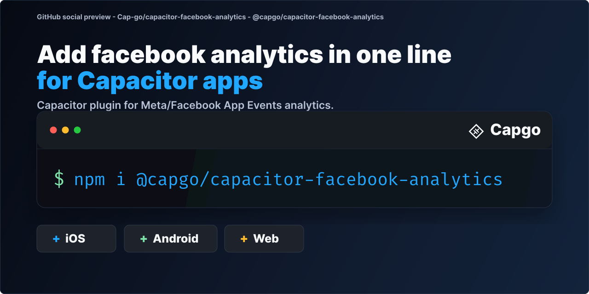

# @capgo/capacitor-facebook-analytics

Send Meta (Facebook) App Events from your Capacitor app on iOS and Android to measure installs, purchases and conversions for your Meta ad campaigns.

<a href="https://capgo.app/?ref=plugin_facebook_analytics"></a>

<div align="center">
  <p><b>Capgo</b>: push fixes to your Capacitor users in minutes, build signed iOS and Android apps without a Mac, and roll back in one click.</p>
  <h2><a href="https://capgo.app/register/?ref=plugin_facebook_analytics">➡️ Get started for free</a></h2>
  <p>14-day unlimited free trial. No credit card required</p>
</div>

> 🤖 **Building with an AI coding agent?** Install [Capgo skills](https://capgo.app/skills/?ref=plugin_facebook_analytics) so Claude Code, Codex, Cursor, Copilot, or Gemini CLI know how to install and use `@capgo/capacitor-facebook-analytics` in your Capacitor app: `npx skills add Cap-go/capgo-skills`. Then ask your agent: *"Add @capgo/capacitor-facebook-analytics to my Capacitor app and wire it up."* [Agent setup guides](https://capgo.app/agents/?ref=plugin_facebook_analytics) · [Hosted MCP](https://capgo.app/docs/ai/mcp/?ref=plugin_facebook_analytics)

<p align="center">
  
</p>

## Built and maintained with AI

We build, improve and fix our plugins with heavy use of AI, so issues usually get fixed in under a day and pull requests get feedback the same day. A human still reviews, tests and merges 50+ pull requests daily.

- Most plugin issues get a fix pull request the same day, often within a couple of hours, and are usually resolved in one to two days.
- Every pull request goes through our AI review system, usually within minutes.
- Our AI pre-checks tests, code review, conventions and security, then a human reviews, tests and merges.
- A human, Martin, reviews, tests and merges 50+ pull requests every day.
- In the last 90 days, 95% of plugin issues were resolved.

[Learn more about how we build with AI](https://capgo.app/docs/plugins/ai-engineering/)

## Key features

- **App Events**: `initAppEvents()` starts the Facebook SDK and activates App Events.
- **Custom events**: `logEvent()` logs any event with parameters.
- **Purchases**: `logPurchase()` logs revenue with currency.
- **Advertiser tracking**: `enableAdvertiserTracking()`, `disableAdvertiserTracking()` and `getAdvertiserTrackingStatus()`. On iOS 17 and later the status reflects App Tracking Transparency. On iOS 16 and earlier the setters change the Facebook SDK flag.
- **Platforms**: iOS and Android. Uses the official Facebook SDKs. Event logging is not available on web.

## Install

You can use our AI-Assisted Setup to install the plugin. Add the Capgo skills to your AI tool using the following command:

```bash
npx skills add https://github.com/cap-go/capacitor-skills --skill capacitor-plugins
```

Then use the following prompt:

```text
Use the `capacitor-plugins` skill from `cap-go/capacitor-skills` to install the `@capgo/capacitor-facebook-analytics` plugin in my project.
```

If you prefer Manual Setup, install the plugin by running the following commands and follow the platform-specific instructions below:

```bash
bun add @capgo/capacitor-facebook-analytics
bunx cap sync
```

## Usage

```ts
import {
  FacebookAnalytics,
  FacebookEventName,
  FacebookEventParameterName,
} from '@capgo/capacitor-facebook-analytics';

await FacebookAnalytics.enableAdvertiserTracking();
await FacebookAnalytics.initAppEvents();

await FacebookAnalytics.logEvent({
  event: FacebookEventName.CompletedRegistration,
  params: {
    [FacebookEventParameterName.RegistrationMethod]: 'email',
  },
});

await FacebookAnalytics.logEvent({
  event: FacebookEventName.AddedToCart,
  valueToSum: 19.99,
  currency: 'USD',
  params: {
    [FacebookEventParameterName.ContentType]: 'product',
    [FacebookEventParameterName.ContentId]: 'sku-123',
  },
});

await FacebookAnalytics.logPurchase({
  amount: 9.99,
  currency: 'USD',
});
```

## Native Setup

Configure the Meta app id and client token in your native app. This plugin does not create those values for you.

### iOS

Add your Meta values to the app `Info.plist`:

```xml
<key>FacebookAppID</key>
<string>YOUR_FACEBOOK_APP_ID</string>
<key>FacebookClientToken</key>
<string>YOUR_FACEBOOK_CLIENT_TOKEN</string>
<key>FacebookDisplayName</key>
<string>YOUR_APP_NAME</string>
```

When advertiser tracking is allowed by your consent flow, call `enableAdvertiserTracking()` before logging events.

If automatic Meta App Event logging is disabled (`FacebookAutoLogAppEventsEnabled` = `false`) so initialization can wait for consent, call `initAppEvents()` only after that consent and ATT flow. On iOS this initializes FBSDK before activating App Events. On Android, `FacebookInitProvider` normally performs basic `sdkInitialize()` at startup while `AutoInitEnabled` and `AutoLogAppEventsEnabled` control full initialization and automatic event logging; `initAppEvents()` completes basic init when needed (for example if the provider was removed) and then calls `activateApp()`. Do not call `ApplicationDelegate.shared.initializeSDK()` from `AppDelegate` in that flow; it would start Meta before those gates pass.

### Android

Add your Meta values to the app `AndroidManifest.xml`:

```xml
<meta-data android:name="com.facebook.sdk.ApplicationId" android:value="@string/facebook_app_id" />
<meta-data android:name="com.facebook.sdk.ClientToken" android:value="@string/facebook_client_token" />
```

Add the string resources in `android/app/src/main/res/values/strings.xml`:

```xml
<string name="facebook_app_id">YOUR_FACEBOOK_APP_ID</string>
<string name="facebook_client_token">YOUR_FACEBOOK_CLIENT_TOKEN</string>
```

## Facebook SDK versions

This plugin integrates the official Meta Facebook SDKs. Default versions:

| Platform | Artifact | Default version |
|----------|----------|-----------------|
| iOS (CocoaPods) | `FBSDKCoreKit` | `~> 19.0` (allows 19.x; `pod install` keeps a compatible locked version) |
| iOS (SwiftPM) | [meta/facebook-ios-sdk](https://github.com/meta/facebook-ios-sdk/) | **19.0.1** minimum (`upToNextMajor`) |
| Android | `com.facebook.android:facebook-core` | **19.0.1** |

iOS requires **iOS 15.0** or newer, matching Facebook SDK 19 and this plugin's deployment target.

**Breaking change (iOS):** This release raises the default `FBSDKCoreKit` pin to 19.x. Plugin major version follows Capacitor 8; native Facebook SDK major bumps ship in minor plugin releases rather than a new plugin major. If your app must keep Facebook SDK 18, pin `@capgo/capacitor-facebook-analytics` to the last published release before this SDK bump until you can move to SDK 19.

### Override the Android SDK version

In your Capacitor app root `android/variables.gradle` (or `android/build.gradle`):

```gradle
ext {
    facebookSdkVersion = '19.0.1'
}
```

Gradle passes `rootProject.ext.facebookSdkVersion` into the plugin. Use any compatible 19.x release published on Maven Central.

### Metadata collection and product improvement (SDK 19)

Facebook SDK 19 turns two extra collection features on by default. This plugin does not set either flag, so apps that upgrade to the plugin's SDK 19 pins inherit those defaults. Both features are independent of automatic App Event logging. Setting `com.facebook.sdk.AutoLogAppEventsEnabled` or `FacebookAutoLogAppEventsEnabled` to `false` does not turn them off.

**Event metadata (`AutoLogMetaDataEnabled`)**

Starting on 31 October 2026, the SDK includes the current screen title and the AppLink URL with events logged through the Facebook SDK. This is on by default. Disable it with the snippets below, or turn off "Automatically include more app event details" in Events Manager.

**Product improvement (`AutoLogProductImprovementEnabled`)**

The SDK can also automatically send sampled information about your app, such as the layout of elements on app screens. Meta says this helps improve ads systems and build new features, and is not used for ads delivery. This is on by default and is independent of metadata collection and automatic App Event logging. Disable it with the snippets below, or turn off "Automatically send more app information" in Events Manager.

Set the Android manifest and iOS Info.plist values before Meta SDK initialization (before `FacebookInitProvider` on Android or early FBSDK setup on iOS). Runtime assignments are persisted and take precedence over the manifest or Info.plist values on later launches.

**Android** (app `AndroidManifest.xml`):

```xml
<meta-data android:name="com.facebook.sdk.AutoLogMetaDataEnabled" android:value="false" />
<meta-data android:name="com.facebook.sdk.AutoLogProductImprovementEnabled" android:value="false" />
```

**iOS** (`Info.plist`):

```xml
<key>FBSDKAutoLogMetaDataEnabled</key>
<false/>
<key>FBSDKAutoLogProductImprovementEnabled</key>
<false/>
```

At runtime:

- Android: you can call `FacebookSdk.setAutoLogMetaDataEnabled(false)` and `FacebookSdk.setAutoLogProductImprovementEnabled(false)` before initialization.
- iOS: set `Settings.shared.isMetaDataCollectionEnabled = false` and `Settings.shared.isAutoLogProductImprovementEnabled = false` after Meta SDK initialization. A previously persisted value takes precedence over Info.plist until you change it at runtime.

Setting the metadata flag to `false` clears cached metadata on the device, including the stored screen title and AppLink URLs. Metadata already attached to queued events may still be sent after the flag is disabled. Collection requires both the client flag and the server-side Events Manager control to be enabled.

### iOS dependency resolution

The plugin owns the iOS SDK pins in `CapgoCapacitorFacebookAnalytics.podspec` and `Package.swift`. Upgrade the plugin to get a new default iOS SDK major line. After upgrading, run `bunx cap sync ios` or `npx cap sync ios`, then `pod install` or let Xcode resolve Swift packages.

SwiftPM uses the `facebook-ios-sdk` package identity with the `https://github.com/facebook/facebook-ios-sdk.git` URL so resolution stays compatible when other dependencies still reference that location or name. The SDK home is [meta/facebook-ios-sdk](https://github.com/meta/facebook-ios-sdk/).

If `Podfile.lock` still pins `FBSDKCoreKit` 18.x, `pod install` alone may not satisfy the plugin `~> 19.0` requirement. From the directory that contains your `Podfile`, run `pod update FBSDKCoreKit` (or `bundle exec pod update FBSDKCoreKit` when CocoaPods runs through Bundler), then run `bunx cap sync ios` or `npx cap sync ios` again. Use `pod update FBSDKCoreKit` when you need a newer compatible 19.x release after you already lock a 19.x version.

## Troubleshooting

### `"FacebookAnalytics" plugin is not implemented on android`

This usually means Capacitor did not register the native Android plugin. Check the following:

1. Run `bunx cap sync` after installing or upgrading the plugin.
2. Confirm `@capgo/capacitor-facebook-analytics` is listed in the Android sync output.
3. Add the Meta `ApplicationId` and `ClientToken` entries from the Android setup section above.
4. Upgrade to `@capgo/capacitor-facebook-analytics@8.1.7` or newer if you are on an older build.

If Meta SDK setup is missing, event calls can still reject with a clear error, but the plugin itself should register on Android once sync succeeds.

## API

<docgen-index>

* [`initAppEvents()`](#initappevents)
* [`logEvent(...)`](#logevent)
* [`logPurchase(...)`](#logpurchase)
* [`enableAdvertiserTracking()`](#enableadvertisertracking)
* [`disableAdvertiserTracking()`](#disableadvertisertracking)
* [`getAdvertiserTrackingStatus()`](#getadvertisertrackingstatus)
* [`getPluginVersion()`](#getpluginversion)
* [Interfaces](#interfaces)
* [Type Aliases](#type-aliases)

</docgen-index>

<docgen-api>
<!--Update the source file JSDoc comments and rerun docgen to update the docs below-->

Facebook App Events analytics bridge.

### initAppEvents()

```typescript
initAppEvents() => Promise<void>
```

Initialize the Facebook SDK and activate App Events.

Call this when automatic app event logging is disabled and you want to
start sending events after your consent / ATT flow.

On iOS this initializes FBSDK on the main thread, then activates App
Events.

On Android, `FacebookInitProvider` normally runs basic SDK setup via
`FacebookSdk.sdkInitialize()` at app start. `com.facebook.sdk.AutoInitEnabled`
controls whether that path also calls `FacebookSdk.fullyInitialize()`
(server communication). `com.facebook.sdk.AutoLogAppEventsEnabled`
controls automatic `activateApp()` logging. When the provider was removed
(for example by `@capgo/capacitor-social-login`) or basic init never
completed, this method calls `sdkInitialize()` and waits for its
`InitializeCallback`, then enables full initialization via
`setAutoInitEnabled(true)` before calling `activateApp()`.
`activateApp()` alone is not enough when the SDK was never
initialized or only basic initialization completed.

Do not initialize Facebook from `AppDelegate` for consent-gated apps;
call this method after the user grants advertising measurement consent.

--------------------


### logEvent(...)

```typescript
logEvent(options: LogEventOptions) => Promise<void>
```

Log a Facebook App Event.

| Param         | Type                                                        |
| ------------- | ----------------------------------------------------------- |
| **`options`** | <code><a href="#logeventoptions">LogEventOptions</a></code> |

--------------------


### logPurchase(...)

```typescript
logPurchase(options: LogPurchaseOptions) => Promise<void>
```

Log a Facebook purchase event.

| Param         | Type                                                              |
| ------------- | ----------------------------------------------------------------- |
| **`options`** | <code><a href="#logpurchaseoptions">LogPurchaseOptions</a></code> |

--------------------


### enableAdvertiserTracking()

```typescript
enableAdvertiserTracking() => Promise<void>
```

Enable advertiser tracking.

On iOS 16 and below this sets `Settings.shared.isAdvertiserTrackingEnabled`.
On iOS 17 and above FBSDK v17+ reads App Tracking Transparency directly.
On Android this enables advertiser ID collection.

--------------------


### disableAdvertiserTracking()

```typescript
disableAdvertiserTracking() => Promise<void>
```

Disable advertiser tracking.

On iOS 16 and below this sets `Settings.shared.isAdvertiserTrackingEnabled`.
On iOS 17 and above FBSDK v17+ reads App Tracking Transparency directly.
On Android this disables advertiser ID collection.

--------------------


### getAdvertiserTrackingStatus()

```typescript
getAdvertiserTrackingStatus() => Promise<AdvertiserTrackingStatusResult>
```

Get the current advertiser tracking status.

On iOS 17 and above this reflects App Tracking Transparency authorization.

**Returns:** <code>Promise&lt;<a href="#advertisertrackingstatusresult">AdvertiserTrackingStatusResult</a>&gt;</code>

--------------------


### getPluginVersion()

```typescript
getPluginVersion() => Promise<PluginVersionResult>
```

Returns the platform implementation version marker.

**Returns:** <code>Promise&lt;<a href="#pluginversionresult">PluginVersionResult</a>&gt;</code>

--------------------


### Interfaces


#### LogEventOptions

| Prop             | Type                                                                | Description                                                                                                                       |
| ---------------- | ------------------------------------------------------------------- | --------------------------------------------------------------------------------------------------------------------------------- |
| **`event`**      | <code>string</code>                                                 | Facebook standard event name or a custom app event name.                                                                          |
| **`valueToSum`** | <code>number</code>                                                 | Optional numeric value to sum for this event.                                                                                     |
| **`currency`**   | <code>string</code>                                                 | Optional ISO 4217 currency code for value-bearing standard events. This is forwarded as Facebook's `fb_currency` event parameter. |
| **`params`**     | <code><a href="#facebookeventparams">FacebookEventParams</a></code> | Optional event parameters.                                                                                                        |


#### LogPurchaseOptions

| Prop           | Type                                                                | Description                   |
| -------------- | ------------------------------------------------------------------- | ----------------------------- |
| **`amount`**   | <code>number</code>                                                 | Purchase amount.              |
| **`currency`** | <code>string</code>                                                 | ISO 4217 currency code.       |
| **`params`**   | <code><a href="#facebookeventparams">FacebookEventParams</a></code> | Optional purchase parameters. |


#### AdvertiserTrackingStatusResult

| Prop         | Type                 | Description                         |
| ------------ | -------------------- | ----------------------------------- |
| **`status`** | <code>boolean</code> | Current advertiser tracking status. |


#### PluginVersionResult

| Prop          | Type                | Description                                                 |
| ------------- | ------------------- | ----------------------------------------------------------- |
| **`version`** | <code>string</code> | Version identifier returned by the platform implementation. |


### Type Aliases


#### FacebookEventName

Facebook standard event names.

<code>(typeof <a href="#facebookeventname">FacebookEventName</a>)[keyof typeof FacebookEventName]</code>


#### FacebookEventParams

Event parameters keyed by Facebook standard parameter names or custom names.

<code><a href="#record">Record</a>&lt;<a href="#facebookeventparametername">FacebookEventParameterName</a> | string, <a href="#facebookeventparamvalue">FacebookEventParamValue</a>&gt;</code>


#### Record

Construct a type with a set of properties K of type T

<code>{
 [P in K]: T;
 }</code>


#### FacebookEventParamValue

Values accepted by the native Facebook App Events SDKs.

Boolean values are converted to Facebook toggle strings: `true` becomes `"1"`
and `false` becomes `"0"`.

<code>string | number | boolean | null</code>


#### FacebookEventParameterName

Facebook standard event parameter names.

<code>(typeof <a href="#facebookeventparametername">FacebookEventParameterName</a>)[keyof typeof FacebookEventParameterName]</code>

</docgen-api>
